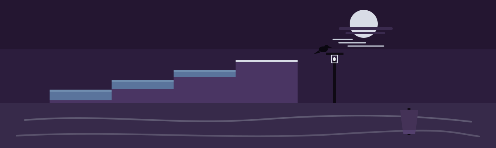

# Private-Chatting-Signal

<p align="center"></p>





I keep this link here because Signal is where I do private chatting. This page is just my pointer to it, so I can find it and share it without digging around.

```
https://signal.org/#signal
```


> **Harbour notice.** This repo is only that pointer. There is no code, no chat content, and
> no account information here.


The site for this repository is a tide table for the same one link, at the address in the repository About field. The artwork files are `intro-banner.png`, `banner.png`, and `logo.png`; the license is the MIT file named `LICENSE`.
